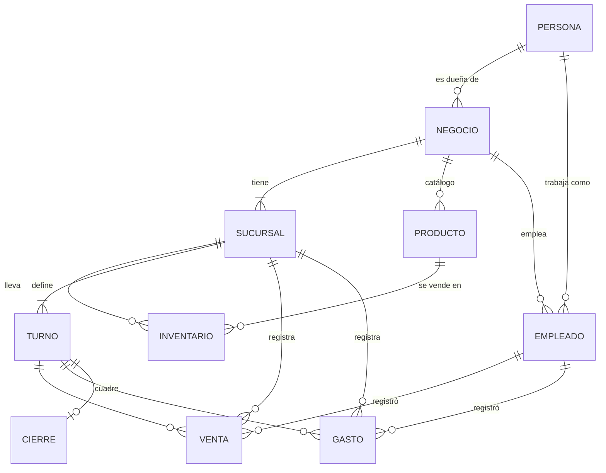

# Modelo de datos de Caja Simple

Referencia para personas y agentes: léelo antes de tocar `src/data/` o `/app/*`.

## Jerarquía

Una **persona** (la cuenta) puede ser **dueña** de varios negocios y **empleada** en otros, a la vez. Cada **negocio** tiene una o más **sucursales**. Cada sucursal lleva su **inventario**, sus **turnos**, sus **ventas** y sus **gastos**.

## Entidades

| Entidad | Pertenece a | Campos clave |
|---|---|---|
| Persona | — | nombre, correo. Es la cuenta: un solo acceso para todos sus negocios. |
| Negocio | su dueña (Persona) | nombre, slug, plan (Gratis / Negocio / Sucursales). |
| Sucursal | Negocio | nombre, slug, dirección. |
| Turno | Sucursal | nombre, inicio, fin, tono (mañana / tarde / noche). Cada sucursal define los suyos. |
| Producto | Negocio | nombre, categoría, código de barras, imagen. Es el **catálogo del negocio**: se define una sola vez. |
| Categoría | Negocio | nombre. Agrupa los productos del catálogo. |
| Inventario | Sucursal × Producto | precio, stock, stock mínimo. Si no existe la fila, esa sucursal no vende el producto. |
| Empleado | Negocio | sucursal, turno, puesto, estado (activo / invitado), persona (si ya tiene cuenta). |
| Venta | Sucursal | turno, empleado, hora, líneas (producto, cantidad). El precio sale del inventario de esa sucursal. |
| Gasto | Sucursal | turno, empleado, hora, concepto, categoría, monto. |
| Cierre de turno | Sucursal × Turno | apertura, estado (en curso / cerrado), diferencia (contado − esperado). |

## Reglas

- El producto es del negocio; el precio, el stock y el mínimo son de cada sucursal.
- Los turnos son de cada sucursal: dos sucursales del mismo negocio pueden tener horarios distintos.
- Toda venta y todo gasto pertenecen a una sucursal, un turno y un empleado.
- Esperado en caja = apertura + ventas − gastos del turno.
- Los montos van en bolivianos (Bs) y se muestran con signo (ver DESIGN.md).
- El plan es de cada negocio y lo paga su dueña, según sus sucursales. Trabajar como empleado nunca cuesta (ver `planes-de-suscripcion.md`).

## Roles y permisos

| Sección | Dueña | Empleada |
|---|---|---|
| Tus negocios (`/app`) | ✓ | ✓ |
| Resumen del negocio, Sucursales, Catálogo, Empleados | ✓ | — |
| Resumen de la sucursal | ✓ | — |
| Registrar venta, Gastos, Turnos | ✓ | ✓ (solo sus sucursales) |
| Inventario | ✓ (edita) | ✓ (consulta) |

## Rutas de la app (objetivo)

| Ruta | Rol |
|---|---|
| `/app` | todos: lista de negocios con el rol en cada uno |
| `/app/[negocio]` | dueña: resumen consolidado |
| `/app/[negocio]/sucursales` | dueña |
| `/app/[negocio]/catalogo` | dueña |
| `/app/[negocio]/empleados` | dueña |
| `/app/[negocio]/sucursales/[sucursal]` | dueña: resumen de la sucursal |
| `/app/[negocio]/sucursales/[sucursal]/{registrar-venta,gastos,inventario,turnos}` | dueña y empleada |

El sitio es estático: el negocio y la sucursal van en la URL (`getStaticPaths`), no en `localStorage`.

## Límites actuales

- `shortcut:` los datos son de ejemplo y viven en memoria (`src/data/mock.ts`); no hay control de acceso real. Cuando exista backend, el rol se valida en el servidor.
- `shortcut:` un empleado está en una sola sucursal y un solo turno; no hay rotación ni traspasos de stock entre sucursales.
- `shortcut:` el sitio es estático, así que el negocio y la sucursal van en la URL y `getStaticPaths` genera solo las rutas que el rol puede ver. Con backend, eso pasa a un middleware que valida la sesión.
- `shortcut:` las categorías del catálogo se guardan en el navegador (`localStorage`, una clave por negocio).
