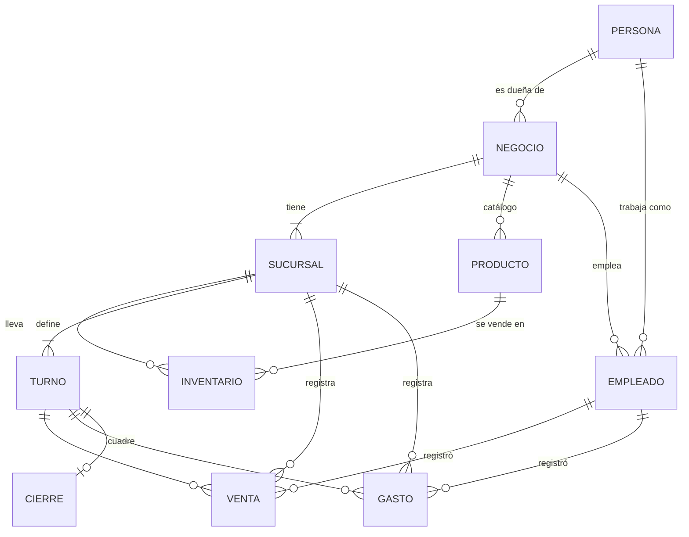

# Modelo de datos de Caja Simple

Referencia para personas y agentes: léelo antes de tocar `src/data/` o `/app/*`.

## Jerarquía

Una **persona** (la cuenta) puede ser **dueña** de varios negocios y **empleada** en otros, a la vez. Cada **negocio** tiene una o más **sucursales**. Cada sucursal lleva su **inventario**, sus **turnos**, sus **ventas** y sus **gastos**.

## Entidades

| Entidad | Pertenece a | Campos clave |
|---|---|---|
| Persona | — | nombre, correo, foto. Es la cuenta: un solo acceso para todos sus negocios. Se edita en `/app/cuenta`. |
| Negocio | su dueña (Persona) | nombre, slug, plan (Gratis / Negocio / Sucursales), descripción (obligatoria al crear; los de antes la agregan al volver a guardar), en Buscar (`listed`, apagado por defecto). |
| Sucursal | Negocio | nombre, slug, dirección. |
| Turno | Sucursal | nombre, inicio, fin, tono (mañana / tarde / noche), archivado. Cada sucursal define los suyos. Si el fin es menor que el inicio, termina al día siguiente. |
| Producto | Negocio | nombre, categoría, código de barras, imagen. Es el **catálogo del negocio**: se define una sola vez. |
| Categoría | Negocio | nombre. Agrupa los productos del catálogo. |
| Promoción | Negocio | `promotions` con sus productos en `promotion_products`. Tres tipos (`kind`): `percent` (un % menos), `price` (precio especial por unidad) y `bundle` (lleva `buy`, paga `pay`). Vale en `branch_ids` (null = todas), los días ISO de `weekdays` (null = todos) y entre `starts_on` y `ends_on` (null = sin límite); `active` la pausa. La ve todo el negocio; la escribe la dueña, solo en planes pagos (trigger `promotions_check_plan`), con `save_promotion`, que guarda la promoción y sus productos en una sola transacción. Se administra en `/app/[negocio]/promociones`. |
| Combo | Negocio | es un producto del catálogo con filas en `product_components` (producto incluido y cantidad, de 1 a 99). Se arma en Catálogo › «Armar combo» (o desde la idea «Arma un combo» del Resumen, `?combo=a,b`). Tiene precio por sucursal pero no stock propio: alcanza para lo que alcancen sus productos (`comboStock()` en `src/data/cash.ts`). No hay combos dentro de combos, y un producto que está en un combo no se borra. |
| Inventario | Sucursal × Producto | precio, stock, stock mínimo. Si no existe la fila, esa sucursal no vende el producto. Las altas en lote (`importProducts` con sucursales, `addToInventory`) solo crean filas: nunca pisan una que ya existe. |
| Empleado | Negocio | correo, persona (vacía hasta que la invitada tenga cuenta), sucursal, turno, puesto, estado (invitado / activo). El nombre se lee del perfil de la persona. |
| Pedido para unirse | Negocio × Persona | sucursal sugerida, mensaje, nombre y correo de quien pide (copiados), estado (pendiente / aceptada / rechazada). Ver abajo › Buscar negocios. |
| Notificación | Persona | tipo, negocio, invitación (si aplica), datos del aviso, leída. |
| Suscripción push | Persona | endpoint y claves de un navegador donde activó los avisos. |
| Venta | Sucursal | turno, empleado, hora, líneas (producto, cantidad). El precio sale del inventario de esa sucursal. |
| Pedido abierto | Sucursal | nombre (mesa, cliente), líneas como las de una venta (`items` jsonb), venta (`sale_id`, vacío mientras está abierto). No descuenta stock hasta cobrarse. |
| Gasto | Sucursal | turno, empleado, hora, concepto, categoría, monto. |
| Cierre de turno | Sucursal × Turno | apertura, estado (en curso / cerrado), diferencia (contado − esperado). |

## Reglas

- El producto es del negocio; el precio, el stock y el mínimo son de cada sucursal.
- Los turnos son de cada sucursal: dos sucursales del mismo negocio pueden tener horarios distintos. Se eligen al crear el negocio o la sucursal (los tres de siempre, o una copia de otra sucursal) y se editan en Turnos.
- Un turno no se borra: se archiva (`archived_at`), así las ventas viejas siguen mostrando su nombre. La sucursal conserva al menos un turno activo.
- Un turno tiene a lo sumo un cierre en curso, y una sucursal a lo sumo una caja abierta: el turno siguiente no se abre (ni se reabre otro) hasta cerrar el que sigue en curso, tampoco la dueña (`private.one_open_per_branch` y el índice `shift_closes_one_open_per_branch_idx`). Lo vendido pasada la medianoche en un turno nocturno cuenta para el día en que se abrió el turno (`business_date` del cierre).
- La fecha de caja de una apertura la pone la base (`private.shift_date`): la de hoy, o la de ayer si el turno cruza la medianoche y se abre pasada ella (22:00–06:00 abierto a las 00:30). Con más de 24 h abierto, la barra del turno avisa que hay que cerrarlo.
- Toda venta y todo gasto pertenecen a una sucursal, un turno y un empleado.
- Esperado en caja = apertura + ventas **en efectivo** − gastos del turno, sin contar lo anulado. QR y transferencia no entran al cajón (`shiftCash()` en `src/data/cash.ts` y `private.on_shift_closed_notify`).
- Cada venta lleva su método de pago (`efectivo`, `qr`, `transferencia`).
- Ventas y gastos no se borran: se anulan (`voided_at`, `voided_by`) y siguen a la vista, tachados y sin sumar. Una venta anulada devuelve su stock. Quien registró algo lo anula o corrige mientras su turno sigue abierto; la dueña, siempre.
- Los montos van en bolivianos (Bs) y se muestran con signo (ver DESIGN.md).
- El plan es de cada negocio y lo paga su dueña, según sus sucursales. Trabajar como empleado nunca cuesta. El plan lo cambia solo un administrador; la dueña puede editar únicamente el nombre del negocio. Los límites (sucursales, historial de 60 días en las políticas de lectura y aviso de descuadre) los aplica la base: ver «Límites en la app» en `planes-de-suscripcion.md`.

## Roles y permisos

| Sección | Dueña | Empleada |
|---|---|---|
| Tus negocios (`/app`) | ✓ | ✓ |
| Resumen del negocio, Sucursales, Catálogo, Empleados | ✓ | — |
| Resumen de la sucursal | ✓ | — |
| Registrar venta, Gastos, Turnos | ✓ | ✓ (solo sus sucursales) |
| Inventario | ✓ (edita) | ✓ (consulta) |
| Equipo de la sucursal (quién trabaja ahí, sin correos) | en Empleados | ✓ (solo sus sucursales) |

## Rutas de la app

| Ruta | Rol |
|---|---|
| `/app` | todos: lista de negocios con el rol en cada uno |
| `/app/cuenta` | todas: perfil, contraseña, verificación en dos pasos, push, descargar tus datos y borrar la cuenta |
| `/app/cuenta/exportar` | todas: descarga en JSON (`exportMyData`, `src/data/account.ts`) |
| `/app/buscar` | todas (menú de Tus negocios): buscar negocios en Buscar, filtrar por rubro y pedir unirse. Ver abajo › Buscar negocios |
| `/app/ayuda` | todas: Ayuda y comentarios (botón del salvavidas en la tarjeta de usuario). Ver abajo › Ayuda y comentarios |
| `/app/[negocio]` | dueña: resumen consolidado |
| `/app/[negocio]/sucursales` | dueña |
| `/app/[negocio]/catalogo` | dueña |
| `/app/[negocio]/empleados` | dueña |
| `/app/[negocio]/configuracion` | dueña: nombre del negocio, sucursales, uso del plan y eliminar |
| `/app/[negocio]/plan` | dueña: planes, precios y métodos de pago |
| `/app/[negocio]/sucursales/[sucursal]` | dueña: resumen de la sucursal |
| `/app/[negocio]/sucursales/[sucursal]/{registrar-venta,ventas,gastos,inventario,turnos}` | dueña y empleada |
| `/app/[negocio]/sucursales/[sucursal]/equipo` | empleada (en su menú): la dueña y las empleadas activas de la sucursal, con puesto y turno |
| `/app/[negocio]/sucursales/[sucursal]/reportes` (y `reportes.csv`) | dueña, en plan Negocio o superior: por día, semana o mes; CSV para Excel e impresión a PDF |

El negocio y la sucursal van en la URL, no en `localStorage`. Las páginas se renderizan en el servidor: el middleware carga la sesión y los negocios de la persona, y una página a la que su rol no tiene acceso responde 404.

## Base de datos (Supabase)

- Esquema en `supabase/migrations/`. Cada entidad de arriba es una tabla de `public`; `sale_totals` es una vista (`security_invoker`) con el total de cada venta.
- **RLS en todas las tablas.** Las funciones de apoyo viven en el schema `private` (no expuesto): `is_owner`, `is_member`, `owns_branch`, `can_use_branch`, `shares_business`.
  - La dueña puede todo en su negocio.
  - La empleada lee el catálogo; lee y escribe ventas, gastos y cierres solo en su sucursal; lee el inventario sin editarlo.
  - Una persona solo ve el perfil (nombre) de quienes comparten negocio con ella.
- **Invitaciones:** la dueña invita con correo, o eligiendo la cuenta entre las sugerencias, y con puesto, sucursal y turno. Por cuenta, la fila se inserta con `person_id` y el correo vacío, y `private.link_invited_employee` lo completa desde `auth.users`. Por correo, si no hay una cuenta confirmada con ese correo, la fila queda con `person_id` en null y `on_employee_invited` llama con `pg_net` a la Edge Function `send-invite`, que manda el correo «Invite user» de Supabase Auth (`inviteUserByEmail`, crea la cuenta sin confirmar). La plantilla de ese correo enlaza a `{{ .SiteURL }}/api/auth/callback?token_hash={{ .TokenHash }}&type=invite`: el callback abre la sesión con `verifyOtp` y lleva a elegir la contraseña. Al confirmarse el correo (por ese enlace o registrándose), `handle_user_confirmed` vincula la fila y crea el aviso `invitation`. `inviteEmployee`: 10 por persona por hora. La fila queda `invitado` y la persona no ve el negocio hasta aceptar desde su bandeja (`respond_invitation`); si rechaza, la fila se borra y la dueña puede volver a invitar.
- **Equipo de la sucursal** (`branch_team`): security definer con `mfa_ok()` y `can_use_branch`. Devuelve a la dueña y a las fichas `activo` de la sucursal con nombre, foto, puesto y turno, sin correos. Por eso la política de `employees` sigue siendo «La dueña ve su equipo; cada quien, su ficha». Va a la caché (`team:<persona>:<sucursal>`, versión del negocio).
- **Sugerencias al invitar** (`search_people`): mientras la dueña escribe un nombre o un correo, la base devuelve cuentas confirmadas, de a 5 por página y desde 3 caracteres, con nombre y foto. Encuentra por el inicio del correo o por el inicio de cualquier palabra del nombre completo, sin distinguir tildes (`private.fold`). Si encontró por correo, lo devuelve completo; si encontró por nombre, enmascarado («an•••@gmail.com», `private.mask_email`, `by_email = false`), para que nadie junte correos buscando nombres comunes. Solo responde a la dueña de ese negocio y deja fuera a ella misma y a quien ya está en el equipo. Al invitar, la dueña sí ve el correo completo de esa persona en su equipo.
- **Notificaciones** (`notifications`): las crean funciones de `private`, nunca la API; cada persona solo lee, borra y marca como leídos sus avisos (`update` solo de `read_at`). Tipos: `invitation` (a la invitada), `invitation_answer` (a la dueña), `shift_closed` (a la dueña, por cada turno que cierra otra persona, cuadre o no, en todos los planes; reemplaza a `cash_mismatch`, que solo avisaba descuadres en planes pagos y se sigue mostrando en los avisos viejos) `low_stock` (a la dueña, cuando una venta deja el stock en el mínimo o debajo; una vez por cruce) `shift_change` (a la dueña, cuando una empleada cambia su turno), `shift_reminder` (a quienes trabajan en el turno, o a la dueña si nadie está asignado: 60, 30, 15 y 5 minutos antes de la hora de abrir) `shift_late` (a la dueña, si a los 5 minutos de la hora el turno sigue sin abrir; ambos los crea el cron `shift-reminders`, cada minuto), `shift_overdue` (a la dueña y a quien lo abrió, si el turno sigue abierto 5 minutos después de su hora de cierre; también del cron, y se repite cada día a esa hora mientras siga abierto), y `plan_expiring` / `plan_expired` (a la dueña, por el vencimiento del plan). Cada persona borra los suyos uno por uno o con «Limpiar»; las invitaciones sin responder no se borran. `data` guarda nombres y montos del momento.
- **Triggers:** al registrarse se crea `profiles`. Cada línea de venta toma el precio del inventario, el descuento de la promoción que vale ese día (`private.promo_discount`, con el día real de la venta: `occurred_at` en hora de Bolivia, así un turno nocturno después de medianoche ya es el día siguiente; si valen varias, la que más descuenta, sin sumarse) y descuenta el stock. El descuento queda en `sale_items.discount` (y `promotion_id`): `unit_price` es el precio de lista y el monto de la línea es `qty * unit_price - discount` en `sale_totals`, `business_stats` y la app. `src/lib/promos.ts` repite la cuenta solo para mostrarla al vender (`private.take_stock`); la de un combo lo descuenta de cada producto que incluye y guarda lo descontado en `sale_items.components`, que `void_sale` usa para devolverlo. La fila de inventario de un combo nunca lleva stock (`inventory_combo_without_stock`); ventas y gastos exigen que su turno esté abierto y toman la fecha del cierre (`private.require_open_shift`). Un turno solo se abre dentro de su horario, desde 15 minutos antes de empezar hasta la hora de cierre y en hora de Bolivia (`private.check_shift_schedule`; el mismo cálculo está en `inShiftWindow()` de `src/lib/dates.ts`). La dueña puede abrirlo fuera de horario: en Turnos la app se lo hace confirmar.
- **RPC:** `register_sale` (venta y líneas en una transacción) y `create_business` (negocio, primera sucursal y turnos).
  - `register_sale(p_sale, …)` es la única forma de escribir ventas (no hay insert directo en `sales` ni `sale_items`). El id lo genera el navegador: si la misma venta llega dos veces, devuelve la primera. Inserta las líneas ordenadas por producto para que dos ventas a la vez bloqueen el inventario en el mismo orden. `p_sold_at` es la hora del mostrador (también de una venta hecha sin conexión, que llega después): queda en `occurred_at`, acotada entre la apertura del turno y `now()`.
  - `charge_order(p_order, p_sale, …)` cobra un pedido abierto: registra la venta con `register_sale` y pone `orders.sale_id` en la misma transacción (con el mismo `p_sale` devuelve la misma venta). Por RLS, cualquiera de la sucursal crea, edita y descarta pedidos mientras están abiertos; `branch_id` y `sale_id` no se escriben desde el cliente (permisos por columna).
  - `void_sale` anula y devuelve el stock. Los gastos se anulan con un `update` de `voided_at` (no hay delete) y su id también lo manda el navegador.
  - Las funciones `security definer` que llama la app (`register_sale`, `void_sale`, `respond_invitation`, `search_people`…) exigen `private.mfa_ok()` ellas mismas: saltan RLS y con ella la política de la verificación en dos pasos.
  - Grants por columna: `shift_closes` (insert de sucursal, turno y apertura; update de estado y contado), `expenses` y `employees`. Fecha, estado y quién abrió los ponen los triggers.
- **Cierres de turno:** al cerrar, el trigger `on_shift_close` guarda `closed_by` y `closed_at`. La `note` explica un descuadre: se escribe al cerrar o después con `set_close_note`, que solo deja a quien cerró y a la dueña. `reopen_shift` (solo la dueña) vuelve a abrir el último cierre de un turno, de hoy o de ayer: borra lo contado y guarda `reopened_by`/`reopened_at`. Ninguna otra vía puede pasar un cierre de `cerrado` a `en-curso`, porque el trigger lo impide fuera de esa función. Quien trabaja en ese turno (o lo abrió o lo cerró) no lo reabre: lo pide con `request_reopen` (motivo opcional) desde la barra del turno o desde Turnos. El pedido queda en `public.reopen_requests` (uno pendiente por cierre) y la dueña recibe un aviso `reopen_request` con «Aceptar» y «Rechazar». `answer_reopen` (solo la dueña) reabre con `reopen_shift` al aceptar y avisa a quien pidió con `reopen_answer`. Al abrir un turno, Turnos sugiere como apertura lo contado en el último cierre de la sucursal.
- **Movimientos de stock** (`stock_movements`): entradas, mermas y ajustes, con `qty` con signo y motivo (obligatorio salvo en las entradas). Solo se escriben con `record_stock_move`, que bloquea la fila de `inventory`, cambia el stock, no deja que quede negativo y registra el movimiento en una sola transacción. La dueña registra todo directo. La empleada **pide** una entrada (`request_stock_entry` → `stock_requests` y un aviso `stock_request` a la dueña); el stock sube recién cuando la dueña la acepta (`answer_stock_request`, en la campana o en Inventario › «Entradas por aprobar»), y el movimiento queda con `recorded_by` = quien la pidió y `approved_by` = quien la aceptó. La empleada recibe `stock_answer` con la respuesta. Las ventas descuentan stock por su cuenta (`sale_items`) y no aparecen en esta tabla.
- **Vencimiento del plan:** `businesses.plan_until` es el último día pagado (si es null, no vence). `private.effective_plan()` devuelve Gratis cuando ya pasó, y la usan `history_start`, `check_branch_limit` y el aviso de descuadre; la app hace la misma cuenta en `session.ts`. El job de `pg_cron` `plan-daily` corre a las 08:00 de Bolivia y ejecuta `private.plan_daily()`: avisa a 7, 3 y 1 día de vencer (`plan_expiring`) y deja en Gratis los vencidos (`plan_expired`). El plan y `plan_until` los cambia un administrador desde el panel de Supabase.
- **Cobro de planes:** `exchange_rates` (tipo de cambio del BCB por día, lo escribe un cron con pg_net desde `apibcb.cucu.bo`), `billing_settings` (una fila: tasa de impuestos, días de un cobro y datos para pagar) y `plan_charges` (cada cobro con su monto en Bs fijo hasta `expires_at`; solo la dueña lo ve). Los cobros se crean con `create_plan_charge` y se marcan pagados con `private.activate_plan_charge`, que solo usa un administrador. Ver `docs/planes-de-suscripcion.md`.
- **Storage:** buckets privados `product-images` y `branch-images`, ruta `<business_id>/<id>-<timestamp>.<ext>` (nombre nuevo en cada cambio, así se guarda en caché un año sin mostrar la foto vieja); las fotos se muestran con URL firmada por un día. El navegador las achica antes de subirlas (`src/scripts/shrink-image.ts`: WebP de 640 px los productos, 1280 las fachadas, 512 logo y avatar, 1600 los comprobantes). El logo del negocio (`businesses.image_path`, Configuración › Negocio) va en `branch-images` como `<business_id>/<business_id>-<timestamp>.<ext>` y se ve en Tus negocios. El bucket privado `sale-receipts` guarda el comprobante de las ventas por QR o transferencia en `<business_id>/<sale_id>/<uuid>.<ext>`: lo suben las personas del negocio (no se reemplaza; solo la dueña borra) y `attach_sale_receipt` lo anota en `sales.receipt_path` (quien registró la venta, una vez; la dueña, siempre). Al cobrar con conexión es obligatorio; una venta enviada desde la cola sin conexión queda «Sin comprobante» y se adjunta desde Ventas. El bucket `avatars` es público (la foto de perfil se ve en el panel, el combo de invitar y Empleados), ruta `<user_id>/<timestamp>.<ext>`, y cada quien escribe solo en su carpeta.

## Caché (Upstash Redis)

Es opcional: sin `UPSTASH_REDIS_REST_URL`/`UPSTASH_REDIS_REST_TOKEN`, o si Redis falla, todo se lee de Supabase (`src/lib/cache.ts`).

- **Qué se guarda** (solo filas crudas, TTL de 10 min): `s:<persona>` (perfil, negocios con sucursales, fichas de empleado), `b:<persona>:<negocio>` (turnos, productos, categorías, equipo) y `br:<persona>:<sucursal>` (turnos, equipo, categorías). La clave lleva a la persona porque RLS decide qué filas ve cada quien. `img:<bucket>:<ruta>` guarda URLs firmadas hasta 10 min antes de que venzan (un día; los comprobantes, una hora).
- **Qué nunca se guarda:** ventas, gastos, cierres, inventario/stock y avisos.
- **Invalidación por versiones:** cada entrada guarda las versiones de `v:u:<persona>` y `v:b:<negocio>` de las que depende; si cambiaron, se vuelve a leer. El middleware sube la versión de la persona y de todo negocio que veía antes y ve después de cada Action, salvo las de `LIVE_ACTIONS`. Así lo que hace la dueña llega a su equipo sin esperar el TTL. `respondInvitation` sube además la del negocio que invitó.
- Lo que cambie fuera de las Actions (panel de Supabase, triggers sobre datos guardados) se ve al vencer el TTL. La excepción es el plan: el trigger `businesses_bump_cache` sube `v:b:<negocio>` por el REST de Upstash (`pg_net`) cada vez que cambian `plan` o `plan_until`. La URL y el token están en Vault (`upstash_url`, `upstash_token`); si faltan, se espera al TTL.
- **Límite de intentos** (`rateLimit`, claves `rl:`, ventana fija): Supabase Auth ve la IP de Vercel y no la de la persona, así que el límite va aquí. Entrar: 10 por IP cada 5 min y 10 por correo cada 15 min. Crear cuenta: 5 por IP por hora. Código de 2FA (`/api/auth/verify`, `verifyTotp`, `disableTotp`): 5 por persona cada 5 min, con un solo cupo compartido. `searchPeople`: 30 por minuto. Sin Redis deja pasar todo.

## Tu cuenta (`/app/cuenta`)

- **Perfil:** la persona edita `first_name`, `last_name` y `avatar_url` (grant por columna). El correo sale de `auth.users` y no se edita desde la app. Si quita su foto, quedan las iniciales.
- **Contraseña:** `auth.updateUser`. Quien entró con Google puede crear una.
- **Tus turnos de trabajo:** la empleada cambia su turno entre los vigentes de su sucursal con `change_my_shift` (RPC security definer: solo su ficha activa, exige `mfa_ok()` y avisa a la dueña con `shift_change`). La sucursal y el puesto los cambia la dueña en Empleados.
- **Verificación en dos pasos (TOTP):** se activa con un QR y un código, y se desactiva con otro código. Al entrar, si la persona tiene un factor verificado, el login, la vuelta de Google y el middleware la mandan a `/auth/verificar` hasta que escriba el código. La autorización real es una política **restrictiva** `«Exige la verificación en dos pasos»` con `private.mfa_ok()` en **todas las tablas de `public` y en `storage.objects`**: sin `aal2`, esa sesión no lee ni escribe nada. **Toda tabla nueva tiene que llevar esa política.**
- **Notificaciones push:** cada aviso nuevo de `notifications` dispara `private.push_notification()`, que con `pg_net` llama a la Edge Function `send-push` (`supabase/functions/send-push`). La URL del proyecto y el secreto de la llamada están en Vault (`project_url`, `push_webhook_secret`). La función lee `push_subscriptions` de esa persona, manda el aviso con VAPID y borra las suscripciones vencidas. El navegador muestra el aviso con `public/sw.js`; en iPhone solo funciona con la app agregada a la pantalla de inicio (`public/manifest.webmanifest`).
- El «hoy» del negocio es la fecha en `America/La_Paz` (`business_date`).
- **Descargar tus datos:** `/app/cuenta/exportar` devuelve un JSON con el perfil, las fichas de empleada y, por cada negocio propio, todas sus tablas (paginadas de a 1000). Usa la sesión: RLS decide qué entra.
- **Borrar la cuenta** (`deleteAccount`): pide escribir el correo y, si tiene, la contraseña (se comprueba con un cliente aparte para no tocar la sesión). Quita las fotos de los negocios propios y el avatar, y llama a `delete_my_account()` (security definer, `mfa_ok()`): borra sus fichas de empleada y su fila de `auth.users`. La cascada se lleva el perfil y **los negocios de los que es dueña**, con todo su historial. En negocios ajenos sus ventas, gastos y cierres se quedan; solo se pierde quién los registró.
- **Eliminar** (desde Configuración, solo la dueña, escribiendo el nombre para confirmar):
  - **Una sucursal:** se van en cascada sus turnos, ventas, gastos, cierres, inventario y empleados asignados (`sales` y `expenses` también cuelgan de `branches`). La última no se puede borrar (trigger `branches_keep_one`): para cerrarla, se elimina el negocio.
  - **El negocio:** se va todo lo suyo. Antes, el trigger `businesses_clear_sales` borra sus ventas, porque `sale_items.product_id` no tiene cascada (así un producto con ventas no se puede borrar suelto). La acción quita sus fotos de Storage antes del borrado, porque las políticas de Storage necesitan que el negocio exista.

## Límites actuales

- `shortcut:` un empleado está en una sola sucursal y un solo turno; no hay rotación ni traspasos de stock entre sucursales.
- `shortcut:` las notificaciones llegan a la bandeja y por push, sin correo (solo la invitación a quien no tiene cuenta va por correo), sin elegir qué tipos de aviso y sin botón de prueba; no se borran solas.
- `shortcut:` eliminar productos, turnos o sucursales es definitivo (no hay papelera). Ventas y gastos se anulan, no se borran.
- `shortcut:` el plan se activa a mano; no hay vencimiento, recordatorios ni cobro automático.

## Sin conexión (PWA)

- `public/sw.js` se registra en `Layout.astro`. Las navegaciones van primero a la red. Sin red, Vender (`/app/*/sucursales/*/registrar-venta`) se abre desde su última copia y el resto muestra `public/offline.html`. Los archivos con hash de `/_astro` se guardan para que esa copia funcione. Nada de caja, stock ni avisos se sirve desde la caché. La copia de Vender se borra al cerrar sesión.
- **Cola de ventas** (`src/scripts/sale-queue.ts`, en `localStorage`): si `registerSale` no llega al servidor, la venta queda en el dispositivo con su `saleId` y se envía al volver la red, al abrir Vender o con «Enviar ahora». `register_sale` ignora un `saleId` repetido, así que reenviar no duplica. Si el servidor la rechaza (por ejemplo, el turno ya se cerró), queda marcada a la vista hasta que alguien la descarte. Cobrar un pedido abierto sigue pidiendo conexión.
- El carro de cada sucursal se guarda en el dispositivo (`caja:carro:<sucursal>`) y vuelve al abrir Vender. Después de vender, la página no se recarga: el stock de las cards baja ahí mismo.
- `shortcut:` una venta en cola toma la fecha y la hora del servidor al enviarse, no las del mostrador; y la barra del turno no suma las ventas hasta recargar.

## Subir imágenes

Todas las fotos (productos, fachadas, logo, avatar, comprobantes y capturas de ayuda) pasan por `imageFile` (`src/actions/shared.ts`): se mira el contenido del archivo, no el tipo que manda el navegador (`src/lib/image.ts`). Solo se aceptan JPEG, PNG y WebP de hasta 2 MB y 8000 px por lado (40 MP); un HTML, un SVG o un ejecutable con nombre de foto se rechaza. Cada persona sube como mucho 60 por hora (`uploadLimit`), el cuerpo de una Action llega hasta 4 MB (`security.actionBodySizeLimit`) y los buckets repiten tipo y tamaño. Las rutas las arma el servidor, nunca con el nombre del archivo.

## Buscar negocios (`/app/buscar`)

- Aparecen solo los negocios que la dueña activó («Aparecer en Buscar», en Configuración o al crearlo) y que tienen descripción (`check` en la base). Se ve el nombre, el rubro, la descripción, el logo y las sucursales con su dirección; nunca ventas, caja ni equipo.
- `public.search_businesses(q, rubro, página)` (security definer) busca en nombre, descripción y nombre o dirección de las sucursales, 12 por página, y dice qué es la persona en cada uno (`dueño`, `equipo`, `invitado`, `pendiente`). El logo se firma con la sesión de quien busca gracias a la política «Ver logos de negocios en Buscar» de `branch-images`.
- Pedir unirse: `request_join` (Action `requestJoin`, 10 por hora). No se puede pedir al negocio propio, donde ya trabajas, si ya te invitaron ni con otro pedido pendiente. La dueña recibe el aviso `join_request` con «Revisar pedido», que lleva a Empleados › Pedidos para unirse.
- Responder: `answer_join` (Action `answerJoin`), solo la dueña. Al aceptar elige sucursal, turno y puesto, y la persona entra **activa** (sin invitación que aceptar): `link_invited_employee` deja `activo` cuando hay un pedido aceptado en la misma transacción. Quien pidió recibe `join_answer`, aceptado o no.
- `join_requests` se escribe solo con esas funciones; la leen quien pidió y la dueña.

## Ayuda y comentarios

- `/app/ayuda` envía dudas, problemas e ideas con la Action `sendFeedback` (máximo 5 por hora por persona). Cada mensaje queda en `public.feedback` (tipo, mensaje, página de origen, autor y hasta 5 capturas en `images`). La persona solo puede insertar: ni siquiera lee los suyos.
- Las capturas van al bucket privado `feedback-images`, en `<user_id>/<uuid>.<ext>`: cada quien sube solo a su carpeta y nadie las lee desde la app. Se ven en el panel de Supabase (Storage › feedback-images) y sus rutas llegan en el correo.
- Si `RESEND_API_KEY` y `FEEDBACK_EMAIL` están en el entorno, además llega un correo (`src/lib/mail.ts`) con «Responder» dirigido al correo de quien escribió. Si el correo falla, el mensaje igual queda guardado y el error va a los logs (`source: "mail"`).
- Para leerlos: `pnpm dlx supabase db query --db-url "$DB_URL" "select f.created_at, f.kind, p.first_name, f.page, f.message, f.images from feedback f left join profiles p on p.id = f.person_id order by f.created_at desc limit 50;"`
