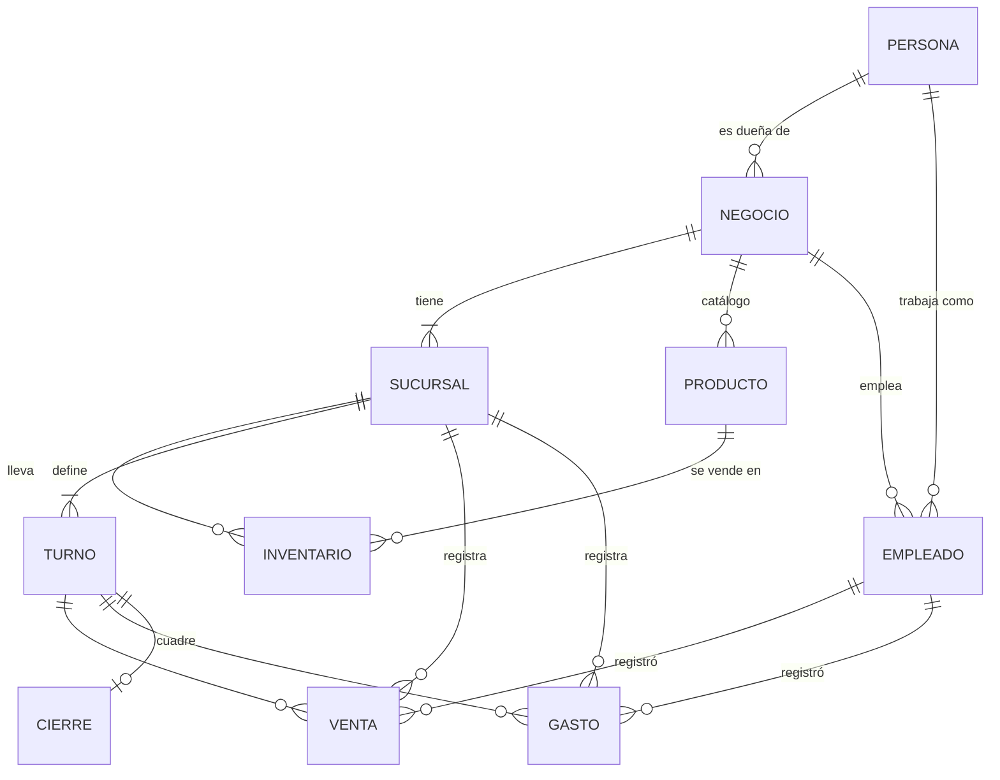

# Modelo de datos de Caja Simple

Referencia para personas y agentes: léelo antes de tocar `src/data/` o `/app/*`.

## Jerarquía

Una **persona** (la cuenta) puede ser **dueña** de varios negocios y **empleada** en otros, a la vez. Cada **negocio** tiene una o más **sucursales**. Cada sucursal lleva su **inventario**, sus **turnos**, sus **ventas** y sus **gastos**.

## Entidades

| Entidad | Pertenece a | Campos clave |
|---|---|---|
| Persona | — | nombre, correo, foto. Es la cuenta: un solo acceso para todos sus negocios. Se edita en `/app/cuenta`. |
| Negocio | su dueña (Persona) | nombre, slug, plan (Gratis / Negocio / Sucursales). |
| Sucursal | Negocio | nombre, slug, dirección. |
| Turno | Sucursal | nombre, inicio, fin, tono (mañana / tarde / noche), archivado. Cada sucursal define los suyos. Si el fin es menor que el inicio, termina al día siguiente. |
| Producto | Negocio | nombre, categoría, código de barras, imagen. Es el **catálogo del negocio**: se define una sola vez. |
| Categoría | Negocio | nombre. Agrupa los productos del catálogo. |
| Inventario | Sucursal × Producto | precio, stock, stock mínimo. Si no existe la fila, esa sucursal no vende el producto. |
| Empleado | Negocio | correo, persona (cuenta existente), sucursal, turno, puesto, estado (invitado / activo). El nombre se lee del perfil de la persona. |
| Notificación | Persona | tipo, negocio, invitación (si aplica), datos del aviso, leída. |
| Suscripción push | Persona | endpoint y claves de un navegador donde activó los avisos. |
| Venta | Sucursal | turno, empleado, hora, líneas (producto, cantidad). El precio sale del inventario de esa sucursal. |
| Gasto | Sucursal | turno, empleado, hora, concepto, categoría, monto. |
| Cierre de turno | Sucursal × Turno | apertura, estado (en curso / cerrado), diferencia (contado − esperado). |

## Reglas

- El producto es del negocio; el precio, el stock y el mínimo son de cada sucursal.
- Los turnos son de cada sucursal: dos sucursales del mismo negocio pueden tener horarios distintos. Se eligen al crear el negocio o la sucursal (los tres de siempre, o una copia de otra sucursal) y se editan en Turnos.
- Un turno no se borra: se archiva (`archived_at`), así las ventas viejas siguen mostrando su nombre. La sucursal conserva al menos un turno activo.
- Un turno tiene a lo sumo un cierre en curso. Lo vendido pasada la medianoche en un turno nocturno cuenta para el día en que se abrió el turno (`business_date` del cierre).
- Toda venta y todo gasto pertenecen a una sucursal, un turno y un empleado.
- Esperado en caja = apertura + ventas − gastos del turno.
- Los montos van en bolivianos (Bs) y se muestran con signo (ver DESIGN.md).
- El plan es de cada negocio y lo paga su dueña, según sus sucursales. Trabajar como empleado nunca cuesta. El plan lo cambia solo un administrador; la dueña puede editar únicamente el nombre del negocio. Los límites (sucursales, un negocio Gratis por persona, historial de 60 días en las políticas de lectura y aviso de descuadre) los aplica la base: ver «Límites en la app» en `planes-de-suscripcion.md`.

## Roles y permisos

| Sección | Dueña | Empleada |
|---|---|---|
| Tus negocios (`/app`) | ✓ | ✓ |
| Resumen del negocio, Sucursales, Catálogo, Empleados | ✓ | — |
| Resumen de la sucursal | ✓ | — |
| Registrar venta, Gastos, Turnos | ✓ | ✓ (solo sus sucursales) |
| Inventario | ✓ (edita) | ✓ (consulta) |

## Rutas de la app

| Ruta | Rol |
|---|---|
| `/app` | todos: lista de negocios con el rol en cada uno |
| `/app/cuenta` | todas: perfil, contraseña, verificación en dos pasos y push |
| `/app/[negocio]` | dueña: resumen consolidado |
| `/app/[negocio]/sucursales` | dueña |
| `/app/[negocio]/catalogo` | dueña |
| `/app/[negocio]/empleados` | dueña |
| `/app/[negocio]/configuracion` | dueña: nombre del negocio, sucursales, uso del plan y eliminar |
| `/app/[negocio]/plan` | dueña: planes, precios y métodos de pago |
| `/app/[negocio]/sucursales/[sucursal]` | dueña: resumen de la sucursal |
| `/app/[negocio]/sucursales/[sucursal]/{registrar-venta,ventas,gastos,inventario,turnos}` | dueña y empleada |

El negocio y la sucursal van en la URL, no en `localStorage`. Las páginas se renderizan en el servidor: el middleware carga la sesión y los negocios de la persona, y una página a la que su rol no tiene acceso responde 404.

## Base de datos (Supabase)

- Esquema en `supabase/migrations/`. Cada entidad de arriba es una tabla de `public`; `sale_totals` es una vista (`security_invoker`) con el total de cada venta.
- **RLS en todas las tablas.** Las funciones de apoyo viven en el schema `private` (no expuesto): `is_owner`, `is_member`, `owns_branch`, `can_use_branch`, `shares_business`.
  - La dueña puede todo en su negocio.
  - La empleada lee el catálogo; lee y escribe ventas, gastos y cierres solo en su sucursal; lee el inventario sin editarlo.
  - Una persona solo ve el perfil (nombre) de quienes comparten negocio con ella.
- **Invitaciones:** la dueña invita con correo, puesto, sucursal y turno. El correo tiene que ser de una cuenta confirmada (si no, la base responde «No hay ninguna cuenta…»). La fila queda `invitado` y la persona no ve el negocio hasta aceptar desde su bandeja (`respond_invitation`); si rechaza, la fila se borra y la dueña puede volver a invitar.
- **Sugerencias al invitar** (`search_people`): mientras la dueña escribe el correo, la base devuelve hasta 6 cuentas confirmadas cuyo correo empieza con lo escrito (desde 3 caracteres), con nombre y foto. Solo responde a la dueña de ese negocio y deja fuera a ella misma y a quien ya está en el equipo.
- **Notificaciones** (`notifications`): las crean funciones de `private`, nunca la API; cada persona solo lee, borra y marca como leídos sus avisos (`update` solo de `read_at`). Tipos: `invitation` (a la invitada), `invitation_answer` (a la dueña), `cash_mismatch` (a la dueña, al cerrar un turno con diferencia, salvo que lo cierre ella) `low_stock` (a la dueña, cuando una venta deja el stock en el mínimo o debajo; una vez por cruce) y `shift_change` (a la dueña, cuando una empleada cambia su turno). Cada persona borra los suyos uno por uno o con «Limpiar»; las invitaciones sin responder no se borran. `data` guarda nombres y montos del momento.
- **Triggers:** al registrarse se crea `profiles`. Cada línea de venta toma el precio del inventario y descuenta el stock; ventas y gastos exigen que su turno esté abierto y toman la fecha del cierre (`private.require_open_shift`). Un turno solo se abre dentro de su horario, desde 15 minutos antes de empezar hasta la hora de cierre y en hora de Bolivia (`private.check_shift_schedule`; el mismo cálculo está en `inShiftWindow()` de `src/lib/dates.ts`). La dueña puede abrirlo fuera de horario: en Turnos la app se lo hace confirmar.
- **RPC:** `register_sale` (venta y líneas en una transacción) y `create_business` (negocio, primera sucursal y turnos).
- **Storage:** buckets privados `product-images` y `branch-images`, ruta `<business_id>/<id>.<ext>`; las fotos se muestran con URL firmada. El bucket `avatars` es público (la foto de perfil se ve en el panel, el combo de invitar y Empleados), ruta `<user_id>/<timestamp>.<ext>`, y cada quien escribe solo en su carpeta.

## Caché (Upstash Redis)

Es opcional: sin `UPSTASH_REDIS_REST_URL`/`UPSTASH_REDIS_REST_TOKEN`, o si Redis falla, todo se lee de Supabase (`src/lib/cache.ts`).

- **Qué se guarda** (solo filas crudas, TTL de 10 min): `s:<persona>` (perfil, negocios con sucursales, fichas de empleado), `b:<persona>:<negocio>` (turnos, productos, categorías, equipo) y `br:<persona>:<sucursal>` (turnos, equipo, categorías). La clave lleva a la persona porque RLS decide qué filas ve cada quien. `img:<bucket>:<ruta>` guarda URLs firmadas 50 min.
- **Qué nunca se guarda:** ventas, gastos, cierres, inventario/stock y avisos.
- **Invalidación por versiones:** cada entrada guarda las versiones de `v:u:<persona>` y `v:b:<negocio>` de las que depende; si cambiaron, se vuelve a leer. El middleware sube la versión de la persona y de todo negocio que veía antes y ve después de cada Action, salvo las de `LIVE_ACTIONS`. Así lo que hace la dueña llega a su equipo sin esperar el TTL. `respondInvitation` sube además la del negocio que invitó.
- Lo que cambie fuera de las Actions (panel de Supabase, triggers sobre datos guardados) se ve al vencer el TTL.
- **Límite de intentos** (`rateLimit`, claves `rl:`, ventana fija): Supabase Auth ve la IP de Vercel y no la de la persona, así que el límite va aquí. Entrar: 10 por IP cada 5 min y 10 por correo cada 15 min. Crear cuenta: 5 por IP por hora. Código de 2FA (`/api/auth/verify`, `verifyTotp`, `disableTotp`): 5 por persona cada 5 min, con un solo cupo compartido. `searchPeople`: 30 por minuto. Sin Redis deja pasar todo.

## Tu cuenta (`/app/cuenta`)

- **Perfil:** la persona edita `first_name`, `last_name` y `avatar_url` (grant por columna). El correo sale de `auth.users` y no se edita desde la app. Si quita su foto, quedan las iniciales.
- **Contraseña:** `auth.updateUser`. Quien entró con Google puede crear una.
- **Tus turnos de trabajo:** la empleada cambia su turno entre los vigentes de su sucursal con `change_my_shift` (RPC security definer: solo su ficha activa, exige `mfa_ok()` y avisa a la dueña con `shift_change`). La sucursal y el puesto los cambia la dueña en Empleados.
- **Verificación en dos pasos (TOTP):** se activa con un QR y un código, y se desactiva con otro código. Al entrar, si la persona tiene un factor verificado, el login, la vuelta de Google y el middleware la mandan a `/auth/verificar` hasta que escriba el código. La autorización real es una política **restrictiva** `«Exige la verificación en dos pasos»` con `private.mfa_ok()` en **todas las tablas de `public` y en `storage.objects`**: sin `aal2`, esa sesión no lee ni escribe nada. **Toda tabla nueva tiene que llevar esa política.**
- **Notificaciones push:** cada aviso nuevo de `notifications` dispara `private.push_notification()`, que con `pg_net` llama a la Edge Function `send-push` (`supabase/functions/send-push`). La URL del proyecto y el secreto de la llamada están en Vault (`project_url`, `push_webhook_secret`). La función lee `push_subscriptions` de esa persona, manda el aviso con VAPID y borra las suscripciones vencidas. El navegador muestra el aviso con `public/sw.js`; en iPhone solo funciona con la app agregada a la pantalla de inicio (`public/manifest.webmanifest`).
- El «hoy» del negocio es la fecha en `America/La_Paz` (`business_date`).
- Si una persona borra su cuenta, sus ventas, gastos y cierres se quedan; solo se pierde quién los registró.
- **Eliminar** (desde Configuración, solo la dueña, escribiendo el nombre para confirmar):
  - **Una sucursal:** se van en cascada sus turnos, ventas, gastos, cierres, inventario y empleados asignados (`sales` y `expenses` también cuelgan de `branches`). La última no se puede borrar (trigger `branches_keep_one`): para cerrarla, se elimina el negocio.
  - **El negocio:** se va todo lo suyo. Antes, el trigger `businesses_clear_sales` borra sus ventas, porque `sale_items.product_id` no tiene cascada (así un producto con ventas no se puede borrar suelto). La acción quita sus fotos de Storage antes del borrado, porque las políticas de Storage necesitan que el negocio exista.

## Límites actuales

- `shortcut:` un empleado está en una sola sucursal y un solo turno; no hay rotación ni traspasos de stock entre sucursales.
- `shortcut:` las notificaciones llegan a la bandeja y por push, sin correo, sin elegir qué tipos de aviso y sin botón de prueba; no se borran solas.
- `shortcut:` eliminar es definitivo (no hay papelera) y no hay anulación de ventas desde la app.
- `shortcut:` el plan se activa a mano; no hay vencimiento, recordatorios ni cobro automático.
